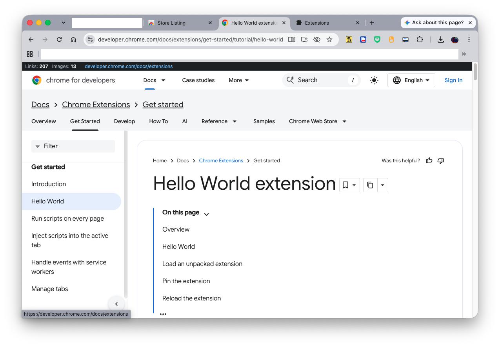
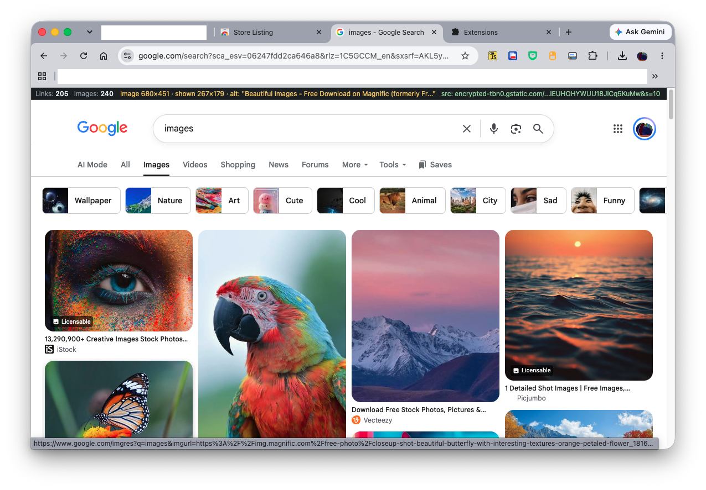
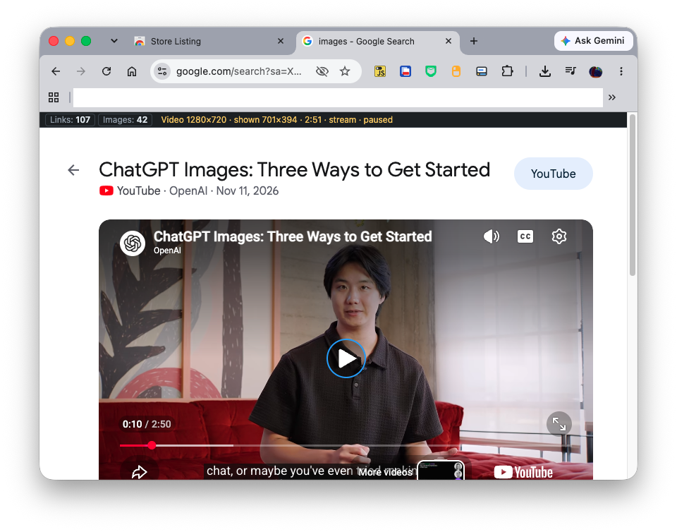
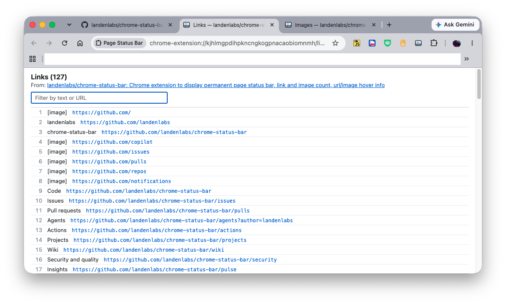
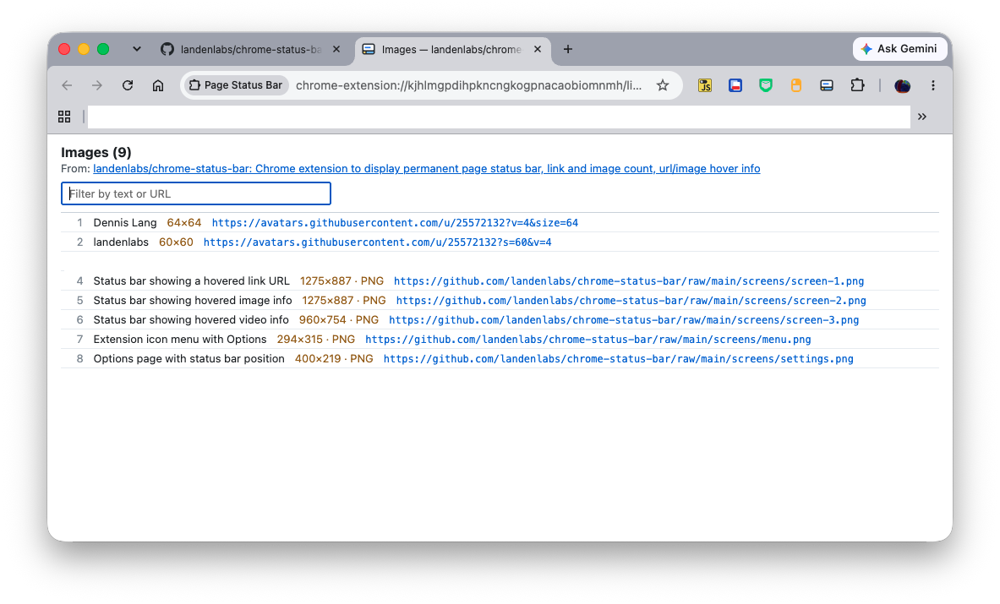
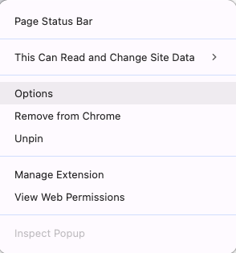
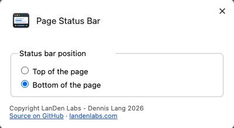

# Page Status Bar

Adds a permanent status bar to the top (or bottom) of every page showing:

- Link and image counts for the current page (updated as the page changes).
  Click **Links** or **Images** to open a new tab listing every link (text and
  URL) or image (alt text, size, type and URL), one row each, with a filter box.
- Image info when hovering over an image.
- Video info (resolution, duration, format, play state) when hovering over a
  video, including embedded players in iframes. Links to video files show the
  format; links to YouTube, Vimeo and similar sites show the site and, when the
  page prints it in the link, the duration.
- The target URL when hovering over a link.

The bar is rendered inside a closed shadow root so page CSS can't affect it
(and it can't affect the page). It only runs in the top-level frame.

## Screenshots

Hovering a link shows its target URL, next to the page's link and image counts:

Hovering an image shows its natural and displayed size, alt text and source:

Hovering a video (here an embedded YouTube player) shows its resolution,
displayed size, duration, format and play state:

Clicking **Links** on the bar opens a tab listing every link on the page (text
and URL), with a filter box:

Clicking **Images** opens a tab listing every image (alt text, size, type and
URL), with a filter box:

## Settings

Open the options (right-click the extension icon → **Options**, or
`chrome://extensions` → **Details** → **Extension options**) to choose whether
the bar sits at the **top** (default) or **bottom** of the page. Open tabs
update right away.

| Extension menu | Options |
| --- | --- |
|  |  |

Note: Chrome's own link-hover URL bubble (bottom-left of the window) can't be
hidden or moved by an extension. Putting this bar at the top keeps the two from
overlapping.

## Load / reload the extension

1. Open `chrome://extensions`.
2. Enable **Developer mode** (top right).
3. Click **Load unpacked** and select this `chrome-status-bar` folder (or
   click the reload icon on the existing card after making changes).
4. Open or reload any page — the status bar appears at the top.

## Files

- `manifest.json` — Manifest V3; injects `content.js` on `<all_urls>`.
- `content.js` — builds the bar and handles counts and hover info (top page only).
- `media.js` — image/video helpers shared by `content.js` and `frame.js`.
- `frame.js` — runs inside iframes; reports a hovered embedded video (YouTube,
  Vimeo, search-result previews) to the bar through `background.js`.
- `background.js` — opens the link/image list tab (content scripts can't open
  tabs; the list is held in `chrome.storage.session` until that tab closes) and
  relays video info from iframes to the bar.
- `list.html` / `list.js` — the link/image list page.
- `options.html` / `options.js` — settings page (bar position, saved in
  `chrome.storage.sync`).
- `icons/` — `icon.svg` (48/128 px) and `icon-small.svg` (16/32 px) sources,
  plus the rendered `icon16/32/48/128.png` used by the manifest.
- `docs/privacy.html` — privacy policy, published with GitHub Pages.

## Privacy

Page Status Bar collects no data. Nothing is tracked, logged or sent anywhere;
everything runs locally in your browser. The only thing saved is the top/bottom
setting (in `chrome.storage.sync`), and link/image lists are kept in memory only
until their tab closes.

Privacy policy: <https://landenlabs.github.io/chrome-status-bar/privacy.html>
(source: [docs/privacy.html](docs/privacy.html))

## Author

Dennis Lang — LanDen Labs — <https://landenlabs.com>

Source: <https://github.com/landenlabs/chrome-status-bar>

## License

Copyright LanDen Labs - Dennis Lang 2026

Apache License 2.0 — see [LICENSE](LICENSE) and [NOTICE](NOTICE).
